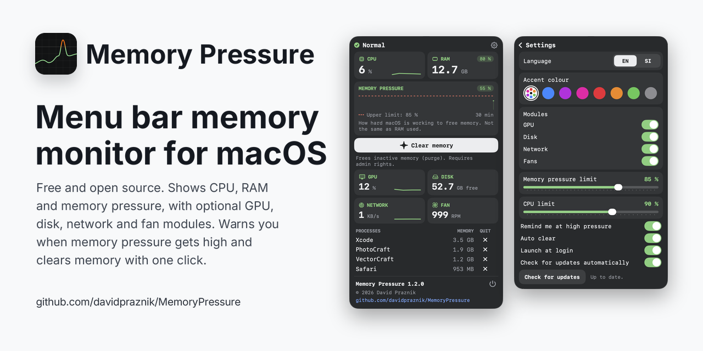

# Memory Pressure

Memory Pressure is a free, open source menu bar app for macOS, written in Swift and SwiftUI. It shows CPU use, RAM use and memory pressure, warns you when memory pressure gets high and can free inactive memory with one click.

## Features

### What it shows

- CPU and RAM use in the menu bar, updated every two seconds.
- A popup with CPU, RAM (used and total), a 30 minute memory pressure chart with your limit marked on it, and the apps using the most memory, each with a quit button.
- Optional modules for GPU, disk, network and fans. Fans appear only on Macs that have one.

### Reminder and auto clear

- A card appears at the top right of the screen when memory pressure reaches your limit. It names the app using the most memory and offers to quit it or clear the cache.
- Auto clear can clear memory by itself when the limit is reached, at most once every 10 minutes. It needs the passwordless rule described below.
- Clear memory frees inactive memory (runs `purge`, which needs administrator rights). The button asks for your password, unless the passwordless rule is set up.

### Memory pressure and RAM are not the same

macOS fills free RAM with cached files on purpose, so a high RAM percentage is normal. Memory pressure shows how hard macOS is working to free memory, and that is what the reminder uses.

## Settings

- Language: English or Slovenian.
- Accent colour: multicolour or one of seven colours, applied across the app.
- Modules: show or hide GPU, disk, network and fans.
- Memory pressure limit: the level at which the reminder and auto clear start.
- CPU limit: the CPU number in the menu bar changes colour at this level.
- Remind me at high pressure: turns the reminder card on or off.
- Auto clear: clears memory by itself when the limit is reached.
- Launch at login.
- Check for updates automatically, and a Check for updates button. When a newer version exists on GitHub, the app tells you and links to the release page. It does not install anything.

## Requirements

- macOS 14.6 or newer.
- Apple silicon or Intel Mac.

## Download

Download the latest `MemoryPressure.zip` from [Releases](https://github.com/davidpraznik/MemoryPressure/releases/latest), unzip it and move MemoryPressure to Applications.

### Opening a downloaded build

The builds are not signed with a paid Apple Developer account and are not notarized, so macOS will block the first launch.

1. Open MemoryPressure once. macOS shows a message that it cannot be opened.
2. Open System Settings > Privacy & Security and scroll down to the Security section.
3. Click Open Anyway next to MemoryPressure and confirm.

You only need to do this once. Alternatively, remove the quarantine flag in Terminal:

    xattr -dr com.apple.quarantine /Applications/MemoryPressure.app

## Clearing memory without a password

`purge` needs administrator rights. By default the Clear memory button shows the macOS password prompt every time, and Auto clear does nothing, because it cannot ask for a password.

To allow `purge` without a password, add a sudoers rule that covers only this one command. Run in Terminal:

    echo "$USER ALL=(root) NOPASSWD: /usr/sbin/purge" | sudo tee /etc/sudoers.d/memorypressure
    sudo chmod 440 /etc/sudoers.d/memorypressure
    sudo visudo -cf /etc/sudoers.d/memorypressure

The last command checks the syntax and should print `parsed OK`. If it reports an error, remove the file with `sudo rm /etc/sudoers.d/memorypressure` and try again.

To undo the rule later:

    sudo rm /etc/sudoers.d/memorypressure

## Build from source

1. Clone the repository.
2. Open `MemoryPressure.xcodeproj` in Xcode.
3. Select the MemoryPressure scheme and press Run (⌘R).

## About

I am David Praznik, a UX/UI and product designer. Memory Pressure started as a tool for my own needs and I am sharing it as it is. It is open source under the MIT licence. If you find a bug or miss something, open an [issue](https://github.com/davidpraznik/MemoryPressure/issues).

## Licence

MIT, see [LICENSE](LICENSE).

Copyright © 2026 David Praznik
